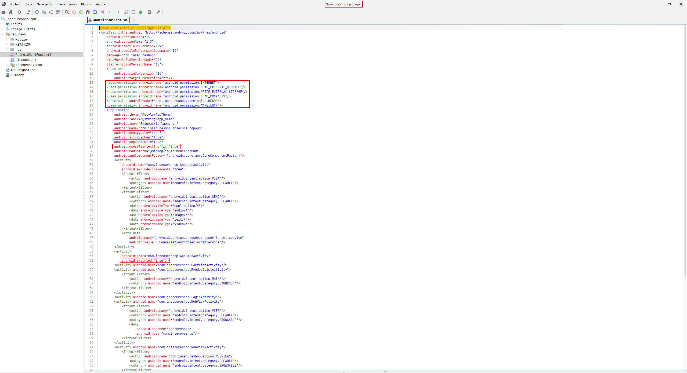

Hello again! In the previous article we took our first steps in the static analysis of Android applications. We saw what it consists of, why it is a fundamental part of any audit and we prepared our arsenal of essential tools. If you remember, I gave a special mention to *Jadx*, saying that it was, without a doubt, the most important tool for reading the code of Android applications. Well, the time has come to keep that promise and put it center stage.

In this post we are going to push *Jadx* to a more advanced level: we will look at the logic behind an analysis, how to follow the trail of data inside the application, how to deal with obfuscated code and what to do when the tool is unable to show us the code.

I assume you already have *Jadx* installed and that you know how to open an *APK* and move around its tabs, since we covered that in the previous article. If not, I recommend you take a look at it before continuing with this article. You can find it [here](https://blog.deephacking.tech/en/posts/introduccion-al-analisis-estatico-en-aplicaciones-android/).

Throughout the article we are going to work with a vulnerable application called ***InsecureShop***, designed precisely to practice this kind of analysis. You can download it from its official website:

- [InsecureShop, the vulnerable Android application](https://insecureshopapp.com/)

The reason for choosing this application is that it has just the right amount of vulnerabilities and components to make the walkthrough entertaining; it is not as simple as some other vulnerable applications whose manual analysis would be very limited, so we will be able to show off a bit more with the different features *Jadx* has to offer.

With that said, let's get to it.

- [The Logic of Analysis: Where to Start with an APK](#the-logic-of-analysis-where-to-start-with-an-apk)
- [Xrefs: Following the Trail Instead of Reading Code](#xrefs-following-the-trail-instead-of-reading-code)
- [Deobfuscation and Renaming: Building Your Own Map](#deobfuscation-and-renaming-building-your-own-map)
- [When Jadx Falls Short: Reading Smali](#when-jadx-falls-short-reading-smali)
- [Exporting the Project: When It Makes Sense and When It Does Not](#exporting-the-project-when-it-makes-sense-and-when-it-does-not)
- [Conclusion](#conclusion)
- [References](#references)

## The Logic of Analysis: Where to Start with an APK

Before touching a single class, it is worth being clear about a concept that many beginners overlook: **static analysis is not about reading code from top to bottom**. A medium-sized application can have hundreds or thousands of classes, and if you start reading them one by one you will go crazy and still not find anything. Static analysis is about **following the data**: identifying where the information we control comes in and chasing it until we see where it ends up and what is done with it along the way.

To organize this process, I always like to follow a similar path. It is not a rule set in stone, but it is a methodology that will serve you as a starting point in practically any audit:

**1. The AndroidManifest.xml.** Always, always start here. As we explained in the previous article, this file is the map of the application. What we look for in a first read is the following:

- The **permissions** requested by the application, which give us a first idea of what it is capable of doing (access to files, the camera, SMS, etc.).
- The **exported components**. An exported component is a component that **another application can access**, that is, an entry point into the application from the outside and, therefore, a fundamental part of our attack surface. A component is considered exported when it explicitly declares `android:exported="true"`, but **watch out for an important detail**: any component that declares an `<intent-filter>` automatically becomes exported even if it does not have that attribute (this was the default behavior until Android 12, when it became mandatory to declare it explicitly). It is a detail that slips past many people and leaves doors open without the developer being aware of it.
- The **deeplinks**, which we will recognize by the `<intent-filter>` tags that contain a `<data android:scheme="...">` along with the `BROWSABLE` category. A deeplink allows a component of the application to be opened from a simple URL, which expands that attack surface even further.
- Dangerous general settings such as `android:debuggable="true"`, `android:allowBackup="true"` or `android:usesCleartextTraffic="true"`.



In the case of *InsecureShop*, a first read of the manifest already leaves us with quite a bit of work on the table. We can see that the application is **debuggable** (`android:debuggable="true"`), allows **backups** (`android:allowBackup="true"`) and accepts **cleartext traffic** (`android:usesCleartextTraffic="true"`). In addition, we find two explicitly exported activities, `AboutUsActivity` and `ResultActivity`, an **exported content provider** (`InsecureShopProvider`) and even an exported service (`UploadService`).

But if there is something that stands out, it is the two activities that handle *WebViews*. On the one hand, the ***WebViewActivity***, which defines a deeplink with the `insecureshop://com.insecureshop` scheme and the `BROWSABLE` category, which means that **we will be able to invoke it from the device's browser with a simple URL**. On the other hand, the ***WebView2Activity***, which is exposed through a custom action (`com.insecureshop.action.WEBVIEW`). Notice that neither of them has the `android:exported="true"` attribute, but both are exported simply because they declare an `<intent-filter>`, just as we have just explained:


**2. From components to code.** Once we have identified the components we are interested in (the entry points), we jump to their code to see how they handle the information they receive. This is where the idea of *source* and *sink*, which we will see in the next section, comes into play. We are especially interested in how the data coming from the outside is retrieved, with calls such as `getIntent()`, `getStringExtra()`, `getData()`, etc.

**3. Searching for sensitive information.** In parallel, we do a sweep with the search tool (remember, the `Ctrl+Shift+F` we saw in the previous article) looking for juicy terms such as `http`, `password`, `token`, `api_key`, `secret` or `key`. As we already mentioned, it is common for developers to leave *hardcoded* credentials, internal server URLs and forgotten *endpoints* inside the code itself.


**4. Reviewing resources and assets.** Not everything is in the code. The *Resources* tab holds the `strings.xml`, configuration files and, sometimes, surprises inside the `assets/` folder. It is always worth taking a look.


## Xrefs: Following the Trail Instead of Reading Code

We now come to what is, for me, the most important feature of *Jadx* and at the same time the most underused by beginners. If in the previous section I told you that static analysis is about following the data, **xrefs** (cross-references) are precisely the tool that allows us to do so.

The idea is simple. The search tool we saw in the previous article gives us **isolated points**: we know that `loadUrl` is used somewhere, that there is a string with `password` somewhere else, etc. But an isolated point does not tell us much. What we are really interested in is **the path that connects those points**: where that data comes from, who calls that method, who reads that field. And that is exactly what xrefs give us.

In *Jadx*, on any class, method, field or constant, we can press the `X` key (or right click → *Find Usage*) to show us **all the places from which that element is referenced**. Get used to using `X` even more than `Ctrl+Shift+F`, because that is what makes the difference between really analyzing and shooting in the dark.


### Source and Sink: The Two Ends of the Path

Before going further, it is worth internalizing two concepts that you will hear constantly in static analysis:

- The **source** is the point where data we control comes in. On Android, the most common *sources* are the data that reach an exported component: what is retrieved with `getIntent()`, `getData()`, `getStringExtra()`, the parameters of a *deeplink*, the information that reaches a *content provider*, etc.
- The **sink** is the point where that data ends up doing something dangerous. We are talking about calls such as `loadUrl()` in a *WebView*, `Runtime.exec()` to execute commands, `rawQuery()` in a database, file operations, etc.

> A vulnerability, in most cases, is nothing more than data that travels from a *source* to a *sink* without anyone validating it along the way. And xrefs are what allow us to follow that journey without having to read the entire class and guess.
> 

### A Real Case in InsecureShop

Let's apply it to the ***WebViewActivity*** we located in the manifest. Remember that it was an exported activity (through its `<intent-filter>`) with a *deeplink* using the `insecureshop://com.insecureshop` scheme. In other words, we have a clear *source*: anyone can invoke this activity from the browser with a URL using that scheme.

The next step is to jump to its code and see what it does with what it receives. When we open the class, we find that it retrieves the data from the *intent* that launched it and, after a check, ends up loading a URL in the *WebView*:


This is where xrefs shine. In this particular case, the *backward* path of the URL (from `loadUrl()` to the initial `getData()`) is short and we can follow it by eye, since everything happens inside the same `onCreate`. But take a look at line 108, right below `loadUrl()`:

```java
Prefs.INSTANCE.getInstance(this).setData(data);
```

The application does not just load the URL: it also **stores it persistently** through `Prefs.setData()`. And here the question arises that we cannot answer by eye: **who else reads that data afterwards?** This is the other direction in which xrefs work. Before, we were chasing the data *backward* to find out where it came from; now we chase it *forward* to see where it goes. To find out, we place ourselves on the `setData` method and press `X`:


The result is revealing. *Jadx* shows us that `setData` is invoked from **two** places: the `WebViewActivity` itself (where we are) and, pay attention, `com.insecureshop.PrivateActivity`. In other words, the data an attacker injects through the deeplink does not stay here, but travels to a completely different activity through `SharedPreferences`. This is something we would never have discovered by reading `WebViewActivity` from top to bottom, and it is the essence of why xrefs are so powerful: they allow us to see how data flows **throughout the entire application**, jumping from one class to another.

By following the complete path we confirm the chain: the deeplink scheme → the retrieval of the `url` parameter in the activity → the `loadUrl()` that loads it → and its persistence in `Prefs`, which other classes will read later on. With this we have not only confirmed the WebView vulnerability, but we have also uncovered a new component, `PrivateActivity`, which we now need to review to see exactly what it does with the data it retrieves. This is how a single finding keeps pulling the thread and expanding the analysis surface.

### Why Xrefs Are Essential with Obfuscated Code

I have saved for last the reason that, personally, makes xrefs the star feature. When we face an obfuscated application (which will be most of the ones you find in the official stores, as we already mentioned in the previous article), the names of classes, methods and variables mean absolutely nothing: we will find things like `a.b.c` or `d(String, int)`. In that scenario, reading the code becomes torture.

However, there is something obfuscation cannot touch: the call graph. Names lie, but who calls whom does not. If we see that the mysterious `a.b.c()` method is invoked from the `onCreate` of the main activity, we already have a huge clue about what it does, even if its name tells us nothing. Xrefs are, on many occasions, the only reliable thing we have left to understand the structure of an obfuscated application, and they are also the first step towards what we will see in the next section: starting to rename things to build our own map.

## Deobfuscation and Renaming: Building Your Own Map

Here it is worth separating from the start two things that many people confuse: the automatic *deobfuscation* that *Jadx* offers and the manual *renaming* we do ourselves. They are not the same, not even close.

### The Jadx Deobfuscator: What It Does and What It Does Not

*Jadx* includes a deobfuscator that is enabled in *File → Preferences → Deobfuscation*. The first thing to understand is what you can expect from it, because the name creates a lot of wrong expectations.


**The deobfuscator does not recover the original names of the code**. That is completely impossible: when a developer obfuscates their application with ProGuard or R8, the original names are destroyed and are not stored anywhere in the APK. What *Jadx* does is something more modest but equally useful: it assigns stable and unique names to the obfuscated elements, so that you can navigate without going crazy. It is the difference between having fifteen classes called `a`, `b`, `c` repeated everywhere, and having names like `C0001a`, `C0002b`, which are at least unambiguous and allow you to keep track of them.

> There is a practical detail that will save you some trouble: decide whether to enable the deobfuscator **at the beginning** of the audit and do not touch it again. If you enable or disable it halfway through the analysis, the generated names change, and all the notes you have been taking (or the renames you have made) will no longer match. It is one of those things you only learn when it happens to you once and you lose half an afternoon.
> 

### Manual Renaming: This Is Where the Real Work Is

If the deobfuscator is the automatic tool, manual renaming is the craftsmanship, and it is where we really build our map of the application. The mechanics are simple: we place ourselves on any class, method, field or variable, press the `N` key (or right click → *Rename*) and give it a name that makes sense to us.


The key is that *Jadx* automatically propagates the change to all references of that element. That is, every time we rename something, all the code that used it instantly becomes more readable. And here a snowball effect takes place: as we understand and rename, `a.b.c` becomes `CryptoHelper`, its `d(String, String)` method becomes `encryptPayload`, and suddenly a class that was unreadable starts telling a story. This is precisely the process that turns an obfuscated application from "impossible to read" into "slow but perfectly manageable".

Since InsecureShop is not obfuscated, its names are already descriptive and we do not need to rename anything to understand it. But the mechanism is identical, and in a truly obfuscated application this is where the technique becomes essential. To illustrate it, I am going to rely on another practice application, OWASP's *UnCrackable App for Android Level 1*, whose code is obfuscated.

Take a look at the following snippet of its `MainActivity`. As soon as we open it we find single-letter classes and methods (`c.a()`, `c.b()`, `c.c()`, `b.a()`, `a.a()`) that, at first glance, tell us absolutely nothing:


And yet, the application gives itself away. This is where what I was telling you comes into play: obfuscation cannot touch text strings. If we look at `onCreate`, we see that the result of `c.a() || c.b() || c.c()` leads to a `"Root detected!"` message, and that `b.a()` does the same with `"App is debuggable!"`. With just that we can already deduce that the `c` package contains the root checks and that `b.a()` is the *debuggable* check, so we could rename them to something like `RootChecker`, `isDeviceRooted()` or `isDebuggable()`. At a glance, and without running anything, we have started to rebuild the map of the application.

### Don't Lose Your Work: The .jadx Project

All this effort of renaming, commenting and organizing has a deadly enemy: closing the window. By default, if you close *Jadx* you will lose all your changes and next time you will have to start from scratch. To avoid this, *Jadx* allows you to save your work in its own project with the `.jadx` extension (*File → Save project*), which keeps the renames, comments and bookmarks you have been adding. Get used to saving the project just as you would save any other document, because a serious analysis is done over several sessions and you will not want to rebuild the map every time.

### What Obfuscation Can't Touch

I will finish with a note that will be very useful when you have to deal with a truly obfuscated app. Even if the names of classes and methods are mangled, there are elements that the obfuscator cannot alter without breaking the application, and they become our best clues to rename with good judgment:

- **Text strings and log messages**, which often give away what a class does.
- **Resource names** (layouts, strings, ids), which remain readable and usually give context about the screen or function they belong to.
- **Annotations** that survive obfuscation. There are two gems here: Gson models' `@SerializedName` and Retrofit interfaces, because they keep the field names and the API *endpoints* intact. In an obfuscated app, finding a Retrofit interface is like finding a treasure map with the complete list of calls to the server.

With the deobfuscator enabled, a good handful of renamed classes and the project saved, we now have a much clearer map of the application. But before closing the topic, we still need to see what to do when *Jadx* is simply unable to show us the code.

## When Jadx Falls Short: Reading Smali

So far we have taken for granted that *Jadx* gives us clean and readable Java code. And most of the time that will be the case. But you should know that *Jadx* fails more often than people think, and you need to be prepared for those moments.

Remember what we already mentioned in the introductory article: *Jadx* does not read Java directly, but rebuilds it from the Dalvik *bytecode* (the `.dex` files). The problem is that there is perfectly valid Dalvik *bytecode* that has no possible translation into Java: control flows that no Java compiler would ever generate, jumps impossible to represent with normal structures, and anti-decompilation tricks that commercial protectors such as DexGuard deliberately add precisely to break tools like this one.

When *Jadx* runs into one of these cases, it will not just hand you the code as if nothing happened. Instead you will find signs like:

- Comments such as `/* JADX WARNING: ... */`.
- The classic `/* Code decompiled incorrectly, please refer to instructions dump */`.
- Methods that appear empty, or directly an exception from the decompiler itself.

And here comes the important part, which is no coincidence: the classes that fail to decompile are usually precisely the most interesting ones. Root checks, anti-tamper protections, license validation, encryption routines... They are often deliberately protected, and the fact that *Jadx* stumbles over them is in itself a clue that there is something there that someone did not want us to read comfortably.

### Seeing the Code Jadx Hides

The first thing I recommend is enabling the *Show inconsistent code* option in the decompilation preferences (*File → Preferences → Decompilation*). With it checked, *Jadx* will show you its best reconstruction attempt even if the result is imperfect, instead of hiding the method from you altogether. It will not be pretty Java, but it is often enough to understand the logic:


When even that does not get us anywhere, it is time to go down a level and read the *smali* directly. Smali, as we mentioned in the previous article, is that kind of "assembly language" for Dalvik *bytecode*. It is much drier than Java, but it has a huge advantage: it is what the application actually executes, so it does not lie or fall short. In *Jadx* we can see the smali of any class by selecting the corresponding tab in the code panel:


### Why This Matters to You: The Link with Frida

At this point, some of you may be wondering why you would want to read smali if your thing is exploitation. Well, there is a very specific reason that connects directly with our articles on dynamic analysis and Frida.

When we want to *hook* a method with *Frida*, we need its exact signature. And if the method is overloaded (several versions with the same name but different parameters), we have to specify the types with an `.overload(...)` to tell *Frida* which one we mean. The problem is that the Java that *Jadx* rebuilds sometimes lies to us about the types: it simplifies, assumes or is simply wrong. Smali, on the other hand, gives us the type descriptors exactly as they are, without any ambiguity.

In other words: when you are going to write a hook on an obfuscated or overloaded method and it does not work, smali is where you will find the real signature you need. It is not about learning smali in depth or programming in it, but about knowing how to read it just enough to extract that information when the Java fails you. That will save you more than one headache when instrumenting an application.

## Exporting the Project: When It Makes Sense and When It Does Not

We close the manual part with a feature that is worth putting in its place: exporting the project. *Jadx* allows you to dump all the decompiled code to disk from *File → Save as gradle project*, leaving us with a folder structure containing the Java code, the resources and the manifest, ready to open with any editor.

Let's separate when it is worth it and when it is not.

It is worth it for:

- Comparing two versions of the same application. This is, for me, the star use case. If you export version 1.2 and 1.3 of an app and run a simple `diff` on them, you will see exactly what has changed between them. In a *retest* this is devastating, because it tells you at a glance whether they have really fixed a finding or just covered it up.
- Running tools over all the code at once. With the code on disk you can run a proper `ripgrep` with regular expressions, or Android-oriented Semgrep rules, over the entire application.

It is not worth it for:

- Reading the code. For reading and navigating, *Jadx-gui* is the way to go, no question. As soon as you export, you lose the `xrefs` and all the navigation between classes, which is precisely what makes the tool useful. Reading exported code in a regular editor is a step backward.
- Feeding it to an AI. Many people export the code with the idea of pasting it into a model for it to analyze. And although the intention is good, feeding a model thousands of lines of code at once is awkward and inefficient, and rarely gives good results.

Finally, I will add a couple of practical warnings: in large applications the export is slow and generates a whole bunch of files, and the exported code does not always compile (remember that it is a reconstruction, not the original source code). So do not get frustrated if you try to open it as a normal project and errors rain down on you; for what it is meant for (diffing and sweeping with tools) it works just as well.

## Conclusion

We have left behind the basic usage we saw in the introductory article to dive into the features that really make a difference when analyzing an application. We have learned that static analysis is not just about reading code, but about following the trail of data with xrefs; we have seen how to build our own map of an obfuscated application through deobfuscation and renaming; we have learned what to do when *Jadx* is unable to show us the code and we need to go down to smali; and we have put project exporting in its place, now knowing what it is really useful for and what it is not.

With all this, you now have a command of *Jadx* well above what most people manage to get out of the tool. My advice is always the same: practice. Grab any of the vulnerable applications spread across the different resources and repositories and spend some time pressing `X`, renaming classes and playing around with its options. There is no better way to internalize all of this than getting your hands dirty.

See you soon with more news. I hope this has helped you take your static analysis to the next level.

Thank you for being on the other side. Cheers! 🙂

## References

- [Jadx on GitHub](https://github.com/skylot/jadx)
- [Jadx official wiki](https://github.com/skylot/jadx/wiki)
- [InsecureShop, the vulnerable Android application](https://insecureshopapp.com/)
- [UnCrackable App for Android Level 1 (OWASP MASTG)](https://github.com/OWASP/mastg/tree/master/Crackmes/Android/Level_01)
- [OWASP Mobile Application Security Testing Guide (MASTG)](https://mas.owasp.org/MASTG/)
- [Frida JavaScript API documentation](https://frida.re/docs/javascript-api/)
