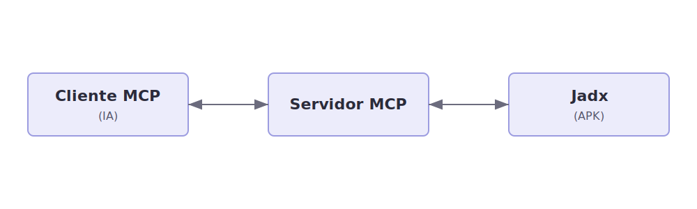

How are you all doing? In the two previous articles we dove into the static analysis of Android applications. First we went through an introduction to this type of analysis and prepared our arsenal of tools, and then we talked specifically about *Jadx* at an advanced level: we learned to follow the trail of data with xrefs, to build our own map of an obfuscated application through renaming, and to deal with smali when the tool could not go any further. And if you remember, throughout that last article I repeated one idea several times: a large part of static analysis is **manual, slow and repetitive** work. Understanding what each class does, renaming it, following a piece of data from one place to another, taking notes... it is a handcrafted process that takes many hours.

Well, we are going to close this mini-series on static analysis of Android applications by learning how we can rely on artificial intelligence to speed up and improve this process, connecting *Jadx* directly to an AI model through what is known as an **MCP server**.

The idea is powerful: instead of copying chunks of code from *Jadx* and pasting them into whatever chat we happen to be using, we are going to give the AI direct access to the application we have open, so that we can have a "conversation" with it while we analyze the *APK* in real time. We will be able to ask it to summarize a class, explain what an obfuscated method does, search for sensitive information or help us trace the path of a piece of data, all while working on our own project.

That said, I want to make one thing clear from the start, and that is why I insisted so much on mastering *Jadx* by hand first: **AI is an aid, not a replacement**. Only if you know how to do the work yourselves will you be able to tell when the tool gets it right and, above all, when it is telling you one of its hallucinations. Keep this in mind throughout the article, because we will come back to it at the end.

With that said, let's get to it.

- [What Is an MCP Server](#what-is-an-mcp-server)
- [Available Repositories and Which One We Choose](#available-repositories-and-which-one-we-choose)
- [Setting Up Our MCP Server](#setting-up-our-mcp-server)
- [Limitations and Risks: Factors to Keep in Mind](#limitations-and-risks-factors-to-keep-in-mind)
- [Conclusion](#conclusion)
- [References](#references)

## What Is an MCP Server

Before configuring anything, it is worth understanding what this MCP thing is and why it is so useful for what we want to do.

MCP stands for *Model Context Protocol*, an open protocol introduced by Anthropic (the company behind *Claude*). The idea behind it is simple to explain: it is a standard that allows an artificial intelligence model to be connected to external tools and data sources in an orderly way. The analogy of the "USB-C port for AI" is often used, and I think it is quite an accurate comparison: in the same way that USB-C is a universal connector into which you can plug a thousand different devices, MCP is a standard way of "plugging" capabilities into a model so that it can interact with the outside world instead of just replying with text.

In practice, an MCP-based system has two parts that communicate with each other:

- The **MCP server**, which exposes a set of tools or data. In our case, it will be the one that gives access to the information of the *APK* we have loaded in *Jadx*.
- The **MCP client**, which is the application from which we talk to the model (for example, *Claude Desktop*) and which connects to the server in order to use those tools.

And why are we so interested in this in our case? Because it solves the biggest nuisance of trying to use AI in a static analysis. Until now, if we wanted a model to give us a hand with an application's code, the only option was to copy fragments from *Jadx* and paste them into the chat by hand. A slow, awkward and very limited process: the model only sees the little piece you paste, it has no context about the rest of the application, and it cannot navigate between classes or follow a reference from one place to another.

> In other words, it would be like asking it to tell us what a book is about by showing it a single page.
> 

With an MCP server connected to *Jadx*, the story changes completely. The model gets direct access to the *APK* we have open: it can read the code of any class, check the *AndroidManifest.xml*, search for text strings, retrieve the xrefs of a method and even rename elements on its own, all on our project and without us having to copy and paste anything. Put another way, we stop working with an AI "in the dark" and instead have an assistant that sees exactly the same thing we do and can play around with the tool while we keep asking it questions.



## Available Repositories and Which One We Choose

The approach we are going to follow consists of installing a plugin inside *Jadx*, which exposes the application's information, and starting an MCP server that acts as a bridge between that plugin and our AI. The beauty of it, as we have already said, is that everything works on the *Jadx* session we have open, in real time.

Well, there are several projects that implement this same idea, and they are all perfectly valid. The two I think are most worth knowing are these:

1. **jadx-ai-mcp, by zinja-coder.** A *Jadx* plugin accompanied by its MCP server, which is part of a broader set of tools (the *Zin MCP Suite*). It is, by far, the most complete and polished of the ones I have tried.
   - [jadx-ai-mcp repository by zinja-coder](https://github.com/zinja-coder/jadx-ai-mcp)
2. **jadx-mcp-plugin, by Mobile Hacking Lab.** Another very solid implementation of the same idea, developed by highly respected people in the mobile hacking field. It is more minimalist: it does what it promises and does it well, but with a more limited set of features.
   - [jadx-mcp-plugin repository by Mobile Hacking Lab](https://github.com/mobilehackinglab/jadx-mcp-plugin)

The plugin I am personally working with is the one by *zinja-coder*, and I will tell you why in case you want to assess it yourselves:

- **It is the most complete in terms of tools.** And here comes the interesting part: the functions it exposes are practically the same ones we learned to use by hand in the previous article (I was already laying the groundwork for this). It can check the *AndroidManifest* and its components, search for classes by keyword within the code, retrieve the xrefs of a class, method or field (our `X`), rename classes, methods, fields, variables and even entire packages (our `N`), and even peek into the *Jadx* debugger. In other words, we give the AI almost the same arsenal we use ourselves.
- **It is actively maintained.** The repository has around 2,700 stars and receives constant updates (at the time of writing this article it is at v6.4.1). In an ecosystem as fast-changing as AI, this is essential, because an abandoned tool stops working within a matter of months.
- **It is well documented.** It has its own documentation page that explains everything from installation to port configuration or creating your own tools, which is greatly appreciated when something does not work the first time.
- **It is compatible with any model.** It works with any client that speaks MCP, which includes the possibility of using it with local models instead of a cloud AI. This point is not a minor one, and we will come back to it at the end of the article when we talk about limitations and, above all, confidentiality.

Let me be clear that this does not mean the other options are bad, far from it. Simply put, for what we are looking for in this article, the *zinja-coder* one is the best fit. I encourage you to try the others and stick with whichever you find most comfortable.

With the choice made, let's get to what really matters: setting up the whole environment.

## Setting Up Our MCP Server

We now come to the most important part of the article. As I mentioned, the setup consists of several pieces that have to talk to each other, so before installing anything it is worth having the overall scheme clear so we do not get lost. The complete communication follows this chain:


Translated into what matters to us, there are three elements:

- The **plugin** *(jadx-ai-mcp)*, which is installed inside *Jadx* and exposes the information of the *APK* we have loaded.
- The **MCP server** *(jadx-mcp-server)*, a separate process that acts as a bridge: on one side it talks to the *Jadx* plugin and on the other to our AI client.
- The **LLM client**, the application from which we talk to the model (in my case *Claude Desktop*) and which we will configure so that it knows where to find the server.

Let's set it up piece by piece.

### Prerequisites

Before continuing, we need to make sure our environment is ready. We will need the following:

- ***Java 11*** or higher, which you should already have installed from the previous article (remember that *Jadx* needs it to work).
- ***Python 3.10*** or higher, to be able to run the MCP server.
- ***uv***, a modern and very fast *Python* package and environment manager, which is the one recommended by the tool for its installation and execution.
- Obviously, *Jadx 1.5.1* or higher in its graphical interface version (*jadx-gui*) and the AI client you are going to use (I will use *Claude Desktop*).


### Installing the Plugin in Jadx

The first step is to get the plugin into *Jadx*. The most convenient way to do this is through the tool's own built-in plugin manager, without having to download or copy files by hand. To do so, inside *jadx-gui* we go to *Plugins* (in the preferences) and use the option to install a new plugin, pointing it to the plugin's location in its repository:


> It is also possible to install the plugin by adding the URL yourself, selecting a previously downloaded *.jar* file or with a command line from the terminal.
> 

Once installed, if we go back to the plugin list we will see that *jadx-ai-mcp* already appears in it. With this, the plugin stays listening, waiting for the MCP server to communicate with it:


### Installing and Starting the Server

With the plugin already inside *Jadx*, it is time to start the second piece: the MCP server, which will act as the intermediary between the plugin and our AI. And here it is worth clarifying something: even though we installed the plugin from *Jadx* itself, **the server is an independent component that has to be installed separately.** They are two different programs, written in different languages (the plugin in *Java*, the server in *Python*) and living in different places, so enabling the plugin is not enough. For the installation we have two options:

1. **Cloning the repository:** This is the method I recommend so as not to fail. You have it at hand in a folder to run it directly and, if it gets updated, we download a new version. You can do it from the following link:
   - [jadx-mcp-server repository](https://github.com/zinja-coder/jadx-mcp-server)
2. **Installing it as a tool:** With this method, the server is installed on our system as just another executable, without leaving loose folders lying around that our configuration depends on. It is installed by running the following command:

```bash
uv tool install git+https://github.com/zinja-coder/jadx-mcp-server
```

> **NOTE:** With the tool installation, *uv* does not leave the `jadx_mcp_server.py` file available to us, but instead installs the server in an isolated environment that it manages itself and makes an executable called `jadx_mcp_server` available in the system PATH. That is why, in the client configuration, it is enough to specify that name without needing any paths. It sounds more convenient, and it is, but keep in mind that this method depends on the project being correctly packaged and on your PATH being properly configured, so it is easy to run into errors that leave the server installed but not working. For that reason I prefer the first option: by cloning the repository we run the code exactly as it is published and we avoid this kind of surprise.
> 

Once the repository is cloned, we will go to the server folder and, before moving on, check with the following command that it responds correctly:

```bash
uv run jadx_mcp_server.py --help
```

This command will show us the server help along with all the parameters it accepts, which serves as validation that everything is in place:


At this point, it is worth explaining a detail where you can get stuck: **the plugin and the server communicate through a port**. The plugin listens on a specific port inside *Jadx*, and the server has to point to that same port in order to talk to it. If they do not match, they will simply not find each other and nothing will work, even if everything else is correctly installed.

In most cases we will not have to touch anything, because the default values are already set up to work locally. But it is important to know that the server accepts a series of parameters to adjust this communication:

- `--jadx-host` and `--jadx-port`: indicate where the *Jadx* plugin the server has to connect to is located.
- `--host` and `--port`: indicate where the MCP server itself listens.

These parameters are what would allow you, for example, to have *Jadx* running on one machine and the server on another. For our scenario, with everything on the same computer, there will be no need to touch them.

Finally, it is worth mentioning that the server runs in *stdio* mode by default, which is the recommended mode for desktop clients like the one we are going to use. There is also an HTTP mode that is enabled with the `--http` flag, but we will not need it here.

### Connecting with the AI Client

We now have the plugin inside *Jadx* and the server ready to run. Only the last piece remains: telling our AI client that this MCP server exists and how to reach it. In my case I am going to use *Claude Desktop*, so we will have to edit its configuration file, `claude_desktop_config.json`. This file **does not exist until we generate it**, so the most convenient way to create it is from the application itself by going to:

- *Settings → Developer → Edit Config*


This will create the file and also open the folder where it is located, which is exactly what we want. And I say that is what we want because **the exact location may vary** depending on how you have installed the application and on its version: the usual place is under the `%APPDATA%\Claude\` path, but in some cases (like mine) it is located in an internal path of the application package, inside `AppData\Local\Packages`. That is why I recommend letting the application itself open the folder for you instead of searching for it by hand.


Once located, the content we have to add to that file is the following:

```json
{
  "mcpServers": {
    "jadx-mcp-server": {
      "command": "C:\\Users\\Casti\\AppData\\Local\\Programs\\Python\\Python313\\Scripts\\uv.exe",
      "args": [
        "--directory",
        "C:\\Tools\\Jadx\\jadx-mcp-server-main",
        "run",
        "jadx_mcp_server.py"
      ]
    }
  }
}
```

> **WARNING:** Two important details. The first is that we have to use **absolute paths**, both for the *uv* executable and for the folder where we have cloned the server. If you do not know where *uv* is, you can quickly find out by running `where uv` in your console. The second is that, since this is a JSON file on *Windows*, the backslashes in the paths have to be written twice as shown above (or you can use forward slashes). **The code above is for my specific case with my specific paths, so you will have to replace them with your own!**
> 

Once this is done, we save the file and close **Claude Desktop** completely to open it again, since the configuration is only loaded at startup. Keep in mind that on *Windows* it is not enough to close the window, because the application keeps running in the background: make sure you close it from the system tray icon.

### About Other AI Models and MCP

Although I use *Claude Desktop* in this article, you are not tied to it at all. The beauty of MCP is precisely that it is a standard, so the server we have just set up will work with any client that supports it. Tools such as *LM Studio*, *Cherry Studio* or *Cursor* allow you to add MCP servers and the process is practically identical to the one we have seen: it is a matter of giving them the command that starts the server along with the path where we have it. If you prefer to work with local models through *Ollama*, keep in mind that it is not an MCP client by itself, but rather the engine that runs the model, so you will need a client to act as an intermediary (the tool's own author has developed one called *Zin MCP Client* designed precisely for this scenario). Where you will run into limitations is with the *ChatGPT* or *Gemini* applications, since their MCP integration is not designed to connect to local servers like ours. In any case, always check your client's documentation, because this ecosystem changes constantly.

- [Zin MCP Client repository](https://github.com/zinja-coder/zin-mcp-client)

### Checking and Running the Environment

With the three pieces in place, let's verify that the connection has been established correctly by following these steps:

**1. Open *Jadx* with the application loaded.** This is essential, so remember it well: the plugin works on the session we have open, so if there is no *APK* loaded, the AI will have absolutely nothing to read. In our case, we will open *InsecureShop*.

**2. Check the plugin status.** From the plugin's own menu inside *Jadx* we can verify that its server is up and listening:


**3. Start the client and verify the tools.** When we start *Claude Desktop*, we can check the status of our server by going to *Settings → Developer*, where we will find the **Local MCP servers** section. Here we will see our server with the *Running* label, along with the command and arguments it was launched with:


Knowing that it is running, all that is left is to make it available in our conversation:


> NOTE: If the server does not appear or shows an error, there are two very quick checks you can do. The first is to manually run the same command the application executes, which saves you from having to guess where the problem is (obviously, replacing the paths with your own):
> 

```powershell
C:\Users\Casti\AppData\Local\Programs\Python\Python313\Scripts\uv.exe --directory C:\Tools\Jadx\jadx-mcp-server-main run jadx_mcp_server.py
```

> If the server starts correctly in the console, the problem is not in the server but in the client configuration, so the second check is to review the JSON file, opening it from the application itself (*Settings → Developer → Edit Config*). As we mentioned before, the location of the file varies depending on the installation, and it is very easy to end up editing a file that the application does not even read, saving the configuration into the void without realizing it. That is exactly what happened to me, and I went crazy looking for the problem where it was not. Also make sure the JSON has no syntax errors, because in that case the application discards the entire file and will not load any server.
> 

**4. The ultimate test.** To finish confirming it, there is nothing better than asking *Claude* something it can only answer if it is really connected. We can start with the simplest thing, asking it directly to list the tools it has available:


If you look at the list, you will see that the available tools are practically a mirror of what we learned to do by hand in the previous article: checking the manifest and its exported components, searching by keyword, retrieving the xrefs of a class or method, renaming elements or going down to the smali of a class. We even find some that go further, such as `fetch_current_class`, which allows *Claude* to directly read the class we have selected at that moment in *Jadx*, so we can ask it to analyze what we are looking at without having to tell it anything else.

At this point, we can happily interact from the chat to analyze the application. Let's look at another couple of simple examples to check what *Claude* answers:


## Limitations and Risks: Factors to Keep in Mind

As convenient as it is to work this way, it is time to come back down to earth, because bringing an AI into an audit does not come for free.

First and most importantly: a language model does not analyze code, it predicts text. It can state with complete conviction that a class does something it does not do, make up a method that does not exist or flag a perfectly protected component as vulnerable, and it will do so in a confident and convincing tone. The same applies as we already discussed with *MobSF*: it does not understand the application's business logic and it will generate false positives, only here they arrive in a conversational tone that is much easier to believe without questioning it. That is why I insisted so much on mastering *Jadx* by hand: everything the AI tells you has to be verified in the code. It is useful for guiding the analysis and saving time on repetitive tasks, never as a source of truth.

On top of this there is a practical limitation: the context is not infinite. In a small application like *InsecureShop* you will not notice it, but in a real app with thousands of classes you cannot ask it to "analyze the entire application" and expect a miracle. You have to narrow it down and ask it about specific classes, components or flows, which is exactly what the previous work on the manifest is useful for.

And we come to the point that matters most to me, which is often overlooked far too lightly: **confidentiality**. When using a cloud AI you are sending the code of the application you are auditing to a third party. In a real engagement that code belongs to a client, usually under a non-disclosure agreement, so uploading it to an external service can get you into trouble. For practicing with vulnerable applications, no problem; for client work, check first. And if the answer is no, you have the alternative of using a local model with *Ollama* through a compatible MCP client so that the code never leaves your environment.

## Conclusion

And that brings this mini-series to an end, which I admit has been quite fun to put together. We have seen what an MCP server is and what it is useful for, we have reviewed the best repositories currently available and we have set up the complete environment piece by piece until we got our AI to directly read the *APK* we have loaded in *Jadx*.

The advantage of this approach is that it does not replace anything we already knew how to do, it simply speeds it up. We still have *Jadx* in front of us, we keep navigating the code and we are still the ones making the decisions, but we get rid of the most repetitive part of the process. Where it shows the most is in obfuscated applications: being able to ask it to interpret and rename classes saves hours of handcrafted work.

That said, I will never tire of repeating it: this is an aid, not a replacement. If you skip the work of learning to do it on your own, sooner or later you will end up accepting a made-up finding as valid. AI will make you go faster, but the judgment has to come from you.

I hope this has been helpful and that you feel encouraged to set it up, because the process is simple and quicker than it seems when reading the article.

Thank you for being on the other side. Cheers! 🙂

## References

- [Model Context Protocol official documentation](https://modelcontextprotocol.io/)
- [jadx-ai-mcp repository by zinja-coder](https://github.com/zinja-coder/jadx-ai-mcp)
- [jadx-mcp-server repository](https://github.com/zinja-coder/jadx-mcp-server)
- [JADX AI MCP documentation](https://jadx-ai-mcp.readthedocs.io/)
- [jadx-mcp-plugin repository by Mobile Hacking Lab](https://github.com/mobilehackinglab/jadx-mcp-plugin)
- [Jadx on GitHub](https://github.com/skylot/jadx)
- [uv documentation](https://docs.astral.sh/uv/)
- [InsecureShop, the vulnerable Android application](https://insecureshopapp.com/)
