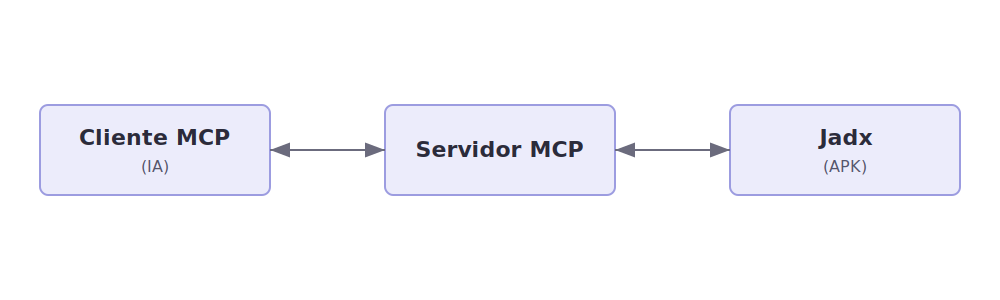

¿Qué tal estáis? En los dos artículos anteriores nos metimos de lleno en el análisis estático de aplicaciones Android. Primero vimos una introducción a este tipo de análisis y preparamos nuestro arsenal de herramientas, y después hablamos particularmente sobre *Jadx* a un nivel avanzado: aprendimos a seguir el rastro de los datos con las xrefs, a construir nuestro propio mapa de una aplicación ofuscada a base de renombrado, y a pelearnos con el smali cuando la herramienta no daba más de sí. Y es que, si recordáis, a lo largo de este último artículo repetí una idea varias veces: gran parte del análisis estático es un trabajo **manual, lento y repetitivo**. Entender qué hace cada clase, renombrarla, seguir un dato de un lado a otro, ir tomando notas... es un proceso artesanal que se lleva muchas horas.

Pues bien, vamos a cerrar esta miniserie del análisis estático en aplicaciones Android aprendiendo cómo podemos apoyarnos en la inteligencia artificial para acelerar y mejorar este proceso, conectando *Jadx* directamente con un modelo de IA a través de lo que se conoce como un **servidor MCP**.

La idea es potente: en lugar de ir copiando trozos de código de *Jadx* y pegándolos en el chat de turno, vamos a darle a la IA acceso directo a la aplicación que tenemos abierta, para poder mantener con ella una "conversación" mientras analizamos la *APK* en tiempo real. Le podremos pedir que nos resuma una clase, que nos explique qué hace un método ofuscado, que busque información sensible o que nos ayude a trazar el recorrido de un dato, todo ello trabajando sobre nuestro propio proyecto.

Eso sí, quiero dejar clara una cosa desde el principio, y por eso he insistido tanto en dominar primero *Jadx* a mano: **la IA es una ayuda, no un sustituto**. Solo si sabéis hacer el trabajo por vosotros mismos seréis capaces de detectar cuándo la herramienta acierta y, sobre todo, cuándo os está contando una de sus alucinaciones. Tenedlo presente durante todo el artículo, porque al final volveremos sobre ello.

Dicho esto, vamos al lío.

- [Qué es un servidor MCP](#qué-es-un-servidor-mcp)
- [Los repositorios disponibles y cuál elegimos](#los-repositorios-disponibles-y-cuál-elegimos)
- [Configurando nuestro servidor MCP](#configurando-nuestro-servidor-mcp)
- [Limitaciones y riesgos: factores a tener en cuenta](#limitaciones-y-riesgos-factores-a-tener-en-cuenta)
- [Conclusión](#conclusión)
- [Referencias](#referencias)

## Qué es un servidor MCP

Antes de realizar ninguna configuración, conviene entender qué es esto del MCP y por qué nos viene tan bien para lo que queremos hacer.

MCP son las siglas de *Model Context Protocol*, un protocolo abierto presentado por Anthropic (la empresa detrás de *Claude*). La idea que hay detrás es sencilla de explicar: es un estándar que permite conectar un modelo de inteligencia artificial con herramientas y fuentes de datos externas de una manera ordenada. Se suele usar el símil del "puerto USB-C de la IA", y creo que es una comparación bastante acertada: de la misma forma que un USB-C es un conector universal al que puedes enchufar mil dispositivos distintos, MCP es una manera estándar de "enchufarle" capacidades a un modelo para que pueda interactuar con el mundo exterior en lugar de limitarse a responder texto.

En la práctica, un sistema basado en MCP tiene dos partes que se comunican entre sí:

- El **servidor MCP**, que es el que expone una serie de herramientas o datos. En nuestro caso, será el que le dé acceso a la información de la *APK* que tenemos cargada en *Jadx*.
- El **cliente MCP**, que es la aplicación desde la que hablamos con el modelo (por ejemplo, *Claude Desktop*) y que se conecta al servidor para poder utilizar esas herramientas.

¿Y por qué nos interesa tanto esto en nuestro caso? Pues porque resuelve el mayor incordio de intentar usar la IA en un análisis estático. Hasta ahora, si queríamos que un modelo nos echase una mano con el código de una aplicación, la única opción era ir copiando fragmentos de *Jadx* y pegándolos a mano en el chat. Un proceso lento, incómodo y muy limitado: el modelo solo ve el trocito que le pegas, no tiene contexto del resto de la aplicación, no puede navegar entre clases ni seguir una referencia de un lado a otro.

> Vamos, que sería como pedirle que nos diga de qué trata un libro enseñándole una sola página.
> 

Con un servidor MCP conectado a *Jadx*, la historia cambia por completo. El modelo pasa a tener acceso directo a la *APK* que tenemos abierta: puede leer el código de cualquier clase, consultar el *AndroidManifest.xml*, buscar cadenas de texto, recuperar las xrefs de un método e incluso renombrar elementos por su cuenta, todo ello sobre nuestro proyecto y sin que nosotros tengamos que estar copiando y pegando nada. Dicho de otro modo, dejamos de trabajar con una IA "a ciegas" para pasar a tener un ayudante que ve exactamente lo mismo que nosotros y que puede trastear con la herramienta a la vez que le vamos preguntando.



## Los repositorios disponibles y cuál elegimos

El enfoque que vamos a seguir consiste en instalar un plugin dentro de *Jadx*, que expone la información de la aplicación, y levantar un servidor MCP que hace de puente entre ese plugin y nuestra IA. La gracia, como ya hemos dicho, es que todo trabaja sobre la sesión de *Jadx* que tenemos abierta, en tiempo real.

Pues bien, hay varios proyectos que implementan esta misma idea, y todos son perfectamente válidos. Los que creo que más merece la pena conocer son estos dos:

1. **jadx-ai-mcp, de zinja-coder.** Un plugin para *Jadx* acompañado de su servidor MCP, que forma parte de un conjunto de herramientas más amplio (la *Zin MCP Suite*). Es, con diferencia, el más completo y trabajado de los que he probado.
   - [Repositorio de jadx-ai-mcp de zinja-coder](https://github.com/zinja-coder/jadx-ai-mcp)
2. **jadx-mcp-plugin, de Mobile Hacking Lab.** Otra implementación muy solvente de la misma idea, desarrollada por gente de mucho prestigio en el sector del hacking móvil. Es más minimalista: hace lo que promete y lo hace bien, pero con un conjunto de funcionalidades más reducido.
   - [Repositorio de jadx-mcp-plugin de Mobile Hacking Lab](https://github.com/mobilehackinglab/jadx-mcp-plugin)

El plugin con el que estoy trabajando personalmente es el de *zinja-coder*, y os cuento los motivos por si queréis valorarlo vosotros mismos:

- **Es el más completo en cuanto a herramientas.** Y aquí viene lo interesante: las funciones que expone son prácticamente las mismas que aprendimos a usar a mano en el artículo anterior (ya fui preparando el terreno para esto). Puede consultar el *AndroidManifest* y sus componentes, buscar clases por palabras clave dentro del código, recuperar las xrefs de una clase, método o campo (nuestro `X`), renombrar clases, métodos, campos, variables y hasta paquetes enteros (nuestro `N`), e incluso asomarse al debugger de *Jadx*. Es decir, le damos a la IA casi el mismo arsenal que manejamos nosotros.
- **Está muy mantenido.** El repositorio ronda las 2.700 estrellas y recibe actualizaciones de forma constante (a fecha de redacción del artículo va por la v6.4.1). En un ecosistema tan cambiante como el de la IA esto es fundamental, porque una herramienta abandonada deja de funcionar en cuestión de meses.
- **Está bien documentado.** Tiene una página de documentación propia donde se explica desde la instalación hasta la configuración de puertos o la creación de tus propias herramientas, algo que se agradece muchísimo cuando algo no va a la primera.
- **Es compatible con cualquier modelo.** Funciona con cualquier cliente que hable MCP, lo que incluye la posibilidad de usarlo con modelos locales en lugar de con una IA en la nube. Este punto no es menor, y volveremos sobre él al final del artículo cuando hablemos de las limitaciones y, sobre todo, de la confidencialidad.

Que quede claro que esto no significa que el resto de opciones sean malas, ni mucho menos. Simplemente, para lo que buscamos en este artículo, el de *zinja-coder* es el que mejor encaja. Os animo a que probéis los demás y os quedéis con el que más cómodo os resulte.

Con la elección hecha, vamos a lo que de verdad importa: montar todo el entorno.

## Configurando nuestro servidor MCP

Llegamos a la parte más importante del artículo. Como os adelanté, el montaje consta de varias piezas que tienen que hablar entre sí, así que antes de empezar a instalar nada conviene tener claro el esquema general para no perdernos. La comunicación completa sigue esta cadena:


Traducido a lo que nos importa, son tres elementos:

- El **plugin** *(jadx-ai-mcp)*, que se instala dentro de *Jadx* y es el que expone la información de la *APK* que tenemos cargada.
- El **servidor MCP** *(jadx-mcp-server)*, un proceso aparte que hace de puente: por un lado habla con el plugin de *Jadx* y por otro con nuestro cliente de IA.
- El **cliente LLM**, la aplicación desde la que conversamos con el modelo (en mi caso *Claude Desktop*) y que configuraremos para que sepa dónde encontrar al servidor.

Vamos a montarlo pieza por pieza.

### Requisitos previos

Antes de continuar, tenemos que asegurarnos de tener el entorno preparado. Necesitaremos lo siguiente:

- ***Java 11*** o superior, que ya deberíais tener instalado del artículo anterior (recordad que *Jadx* lo necesita para funcionar).
- ***Python 3.10*** o superior, para poder ejecutar el servidor MCP.
- ***uv***, un gestor de paquetes y entornos de *Python* moderno y muy rápido, que es el que recomienda la herramienta para su instalación y ejecución.
- Evidentemente, *Jadx 1.5.1* o superior en su versión con interfaz gráfica (*jadx-gui*) y el cliente de IA que vayáis a utilizar (yo usaré *Claude Desktop*).


### Instalación del plugin en Jadx

El primer paso es meter el plugin dentro de *Jadx*. La forma más cómoda de hacerlo es a través del propio gestor de plugins que incorpora la herramienta, sin necesidad de andar descargando ni copiando ficheros a mano. Para ello, dentro de *jadx-gui* accedemos a *Plugins* (en las preferencias) y utilizamos la opción de instalar un plugin nuevo, indicándole la ubicación del plugin en su repositorio:


> También es posible instalar el plugin añadiendo tú a mano la URL, seleccionando un archivo de formato *.jar* descargado previamente o con una línea de comandos desde la terminal.
> 

Una vez instalado, si accedemos de nuevo al listado de plugins veremos que *jadx-ai-mcp* aparece ya en la lista. Con esto, el plugin queda a la escucha esperando a que el servidor MCP se comunique con él:


### Instalación y arranque del servidor

Con el plugin ya dentro de *Jadx*, toca levantar la segunda pieza: el servidor MCP, que es el que hará de intermediario entre el plugin y nuestra IA. Y aquí conviene aclarar una cuestión: aunque el plugin lo hayamos instalado desde el propio *Jadx*, **el servidor es un componente independiente que hay que instalar por separado.** Son dos programas distintos, escritos en lenguajes distintos (el plugin en *Java*, el servidor en *Python*) y que viven en sitios distintos, así que con activar el plugin no es suficiente. Para la instalación tenemos dos caminos:

1. **Clonar el repositorio:** Este es el método que recomiendo para no fallar. Lo tienes a mano en una carpeta para ejecutarlo directamente y si se actualiza, nos descargamos una nueva versión. Podéis hacerlo desde el siguiente enlace:
   - [Repositorio de jadx-mcp-server](https://github.com/zinja-coder/jadx-mcp-server)
2. **Instalarlo como herramienta:** Con este método, el servidor queda instalado en nuestro sistema como un ejecutable más, sin dejar carpetas sueltas por ahí de las que dependa nuestra configuración. Se instala ejecutando el siguiente comando:

```bash
uv tool install git+https://github.com/zinja-coder/jadx-mcp-server
```

> **NOTA:** Con la instalación como herramienta, *uv* no deja el fichero `jadx_mcp_server.py` a nuestra disposición, sino que instala el servidor en un entorno aislado que gestiona él mismo y nos deja disponible un ejecutable llamado `jadx_mcp_server` en el PATH del sistema. De ahí que en la configuración del cliente baste con indicar ese nombre sin necesidad de rutas. Suena más cómodo, y lo es, pero tened en cuenta que este método depende de que el proyecto esté correctamente empaquetado y de que vuestro PATH quede bien configurado, por lo que es fácil encontrarse con errores que os dejen el servidor instalado pero sin funcionar. Por ese motivo prefiero la primera opción: clonando el repositorio ejecutamos el código tal cual está publicado y nos ahorramos este tipo de sorpresas.
> 

Una vez clonado el repositorio, accederemos a la carpeta del servidor y, antes de seguir adelante, comprobaremos con el siguiente comando que responde correctamente:

```bash
uv run jadx_mcp_server.py --help
```

Este comando nos mostrará la ayuda del servidor junto con todos los parámetros que admite, lo cual nos sirve como validación de que está todo en su sitio:


Llegados a este punto, conviene explicar un detalle en el que os podéis atascar: **el plugin y el servidor se comunican a través de un puerto**. El plugin queda escuchando en un puerto determinado dentro de *Jadx*, y el servidor tiene que apuntar a ese mismo puerto para poder hablar con él. Si no coinciden, sencillamente no se encontrarán y no funcionará nada, aunque todo lo demás esté correctamente instalado.

En la mayoría de los casos no vamos a tener que tocar nada, porque los valores por defecto ya están preparados para funcionar en local. Pero es importante saber que el servidor admite una serie de parámetros para ajustar esta comunicación:

- `--jadx-host` y `--jadx-port`: indican dónde está el plugin de *Jadx* al que el servidor tiene que conectarse.
- `--host` y `--port`: indican dónde escucha el propio servidor MCP.

Estos parámetros son los que os permitirían, por ejemplo, tener *Jadx* corriendo en una máquina y el servidor en otra. Para nuestro escenario, con todo en el mismo equipo, no hará falta tocarlos.

Por último, cabe mencionar que el servidor funciona por defecto en modo *stdio*, que es el recomendado para clientes de escritorio como el que vamos a utilizar. Existe también un modo HTTP que se activa con la flag `--http`, pero no lo necesitaremos aquí.

### Conexión con el cliente de IA

Ya tenemos el plugin dentro de *Jadx* y el servidor listo para su ejecución. Solo nos queda la última pieza: decirle a nuestro cliente de IA que ese servidor MCP existe y cómo llegar hasta él. En mi caso voy a utilizar *Claude Desktop*, así que tendremos que editar su fichero de configuración, el `claude_desktop_config.json`. Este fichero **no existe hasta que lo generamos**, así que la manera más cómoda de crearlo es desde la propia aplicación accediendo a:

- *Configuración → Desarrollador → Editar configuración*


Esto nos creará el fichero y, además, nos abrirá directamente la carpeta en la que se encuentra, que es justo lo que nos interesa. Y digo que nos interesa porque **la ubicación exacta puede variar** en función de cómo tengáis instalada la aplicación y de su versión: lo habitual es encontrarlo bajo la ruta `%APPDATA%\Claude\`, pero en algunos casos (como el mío) se encuentra en una ruta interna del paquete de la aplicación, dentro de `AppData\Local\Packages`. Por eso os recomiendo dejar que sea la propia aplicación la que os abra la carpeta en lugar de andar buscándola a mano.


Una vez localizado, el contenido que tenemos que añadir a dicho fichero es el siguiente:

```json
{
  "mcpServers": {
    "jadx-mcp-server": {
      "command": "C:\\Users\\Casti\\AppData\\Local\\Programs\\Python\\Python313\\Scripts\\uv.exe",
      "args": [
        "--directory",
        "C:\\Tools\\Jadx\\jadx-mcp-server-main",
        "run",
        "jadx_mcp_server.py"
      ]
    }
  }
}
```

> **ATENCIÓN:** Dos detalles importantes. El primero es que tenemos que utilizar **rutas absolutas**, tanto para el ejecutable de *uv* como para la carpeta donde hayamos clonado el servidor. Si no sabéis dónde tenéis *uv*, lo podéis averiguar rápidamente ejecutando `where uv` en vuestra consola. El segundo es que, al tratarse de un fichero JSON en *Windows*, las barras invertidas de las rutas hay que escribirlas duplicadas tal y como se muestra arriba (o bien utilizar barras normales). **¡El código anterior es para mi caso en concreto con mis rutas concretas, pero vosotros tendréis que sustituirlas por las vuestras!**
> 

Hecho esto, guardamos el fichero y cerramos **Claude Desktop** por completo para volver a abrirlo, ya que la configuración solo se carga durante el arranque. Tened en cuenta que en *Windows* no basta con cerrar la ventana, porque la aplicación se queda ejecutándose en segundo plano: aseguraos de cerrarla desde el icono de la bandeja del sistema.

### Sobre otros modelos de IA y MCP

Aunque en este artículo utilizo *Claude Desktop*, no estáis atados a él en absoluto. La gracia del MCP es precisamente que es un estándar, así que el servidor que acabamos de montar funcionará con cualquier cliente que lo soporte. Herramientas como *LM Studio*, *Cherry Studio* o *Cursor* permiten añadir servidores MCP y el proceso es prácticamente idéntico al que hemos visto: se trata de indicarles el comando que levanta el servidor junto con la ruta donde lo tenemos. Si preferís trabajar con modelos locales mediante *Ollama*, tened en cuenta que este no es un cliente MCP por sí mismo, sino el motor que ejecuta el modelo, por lo que necesitaréis un cliente que haga de intermediario (el propio autor de la herramienta ha desarrollado uno llamado *Zin MCP Client* pensado justo para este escenario). Donde sí os vais a encontrar limitaciones es con las aplicaciones de *ChatGPT* o *Gemini*, ya que su integración con MCP no está planteada para conectarse a servidores locales como el nuestro. En cualquier caso, revisad siempre la documentación de vuestro cliente, porque este ecosistema cambia constantemente.

- [Repositorio de Zin MCP Client](https://github.com/zinja-coder/zin-mcp-client)

### Comprobación y ejecución del entorno

Con las tres piezas en su sitio, vamos a verificar que la conexión se ha establecido correctamente siguiendo estos pasos:

**1. Abrir *Jadx* con la aplicación cargada.** Esto es fundamental, y recordadlo bien: el plugin trabaja sobre la sesión que tengamos abierta, así que si no hay ninguna *APK* cargada, la IA no tendrá absolutamente nada que leer. En nuestro caso, abriremos *InsecureShop*.

**2. Comprobar el estado del plugin.** Desde el propio menú del plugin dentro de *Jadx* podemos verificar que su servidor se encuentra levantado y a la escucha:


**3. Arrancar el cliente y verificar las herramientas.** Al iniciar *Claude Desktop*, podemos comprobar el estado de nuestro servidor accediendo a *Configuración → Desarrollador*, donde encontraremos el apartado de **Servidores MCP locales**. Aquí veremos nuestro servidor junto con la etiqueta *En ejecución*, además del comando y los argumentos con los que se ha lanzado:


Sabiendo que está corriendo, ya solo nos queda tenerlo disponible en nuestra conversación:


> NOTA: Si el servidor no os aparece o lo hace con algún error, tenéis dos comprobaciones muy rápidas. La primera es lanzar a mano el mismo comando que ejecuta la aplicación, que os ahorra tener que adivinar dónde está el fallo (evidentemente, sustituyendo las rutas por las vuestras):
> 

```powershell
C:\Users\Casti\AppData\Local\Programs\Python\Python313\Scripts\uv.exe --directory C:\Tools\Jadx\jadx-mcp-server-main run jadx_mcp_server.py
```

> Si el servidor arranca correctamente en la consola, el problema no está en él sino en la configuración del cliente, así que la segunda comprobación es revisar el fichero JSON, accediendo desde la propia aplicación (*Configuración → Desarrollador → Editar configuración*). Como comentábamos antes, la ubicación del fichero varía según la instalación, y es muy fácil acabar editando un fichero que la aplicación ni siquiera lee, guardando así la configuración en el vacío sin darnos cuenta. A mí me pasó exactamente eso, y me volví loco buscando el fallo donde no estaba. Aseguraos también de que el JSON no tenga errores de sintaxis, ya que en ese caso la aplicación descarta el fichero entero y no cargará ningún servidor.
> 

**4. La prueba definitiva.** Para terminar de confirmarlo, nada mejor que pedirle a *Claude* algo que solo pueda responder si de verdad está conectado. Podemos empezar por lo más sencillo, pidiéndole directamente que nos liste las herramientas de las que dispone:


Si os fijáis en el listado, veréis que las herramientas disponibles son prácticamente un espejo de lo que aprendimos a hacer a mano en el artículo anterior: consultar el manifest y sus componentes exportados, buscar por palabras clave, recuperar las xrefs de una clase o un método, renombrar elementos o bajar al smali de una clase. Incluso encontramos alguna que va más allá, como `fetch_current_class`, que permite a *Claude* leer directamente la clase que tengamos seleccionada en ese momento en *Jadx*, de manera que podemos pedirle que analice lo que estamos viendo sin necesidad de indicarle nada más.

En este punto, ya podemos interactuar alegremente desde el chat para analizar la aplicación. Vamos a ver otro par de ejemplos sencillos para comprobar qué nos responde *Claude*:


## Limitaciones y riesgos: factores a tener en cuenta

Con lo cómodo que resulta trabajar de esta manera, toca poner los pies en el suelo, porque meter una IA en una auditoría no sale gratis.

Lo primero y más importante: un modelo de lenguaje no analiza código, predice texto. Puede afirmar con total convicción que una clase hace algo que no hace, inventarse un método que no existe o daros por vulnerable un componente perfectamente protegido, y lo hará con un tono seguro y convincente. Se aplica lo mismo que ya comentamos con *MobSF*: no entiende la lógica de negocio de la aplicación y va a generar falsos positivos, solo que aquí llegan en un tono conversacional que resulta mucho más fácil de creer sin cuestionarlo. Por eso he insistido tanto en dominar *Jadx* a mano: todo lo que os diga la IA hay que verificarlo en el código. Sirve para orientar el análisis y para ahorrar tiempo en lo repetitivo, nunca como fuente de verdad.

A esto se suma una limitación práctica: el contexto no es infinito. En una aplicación pequeña como *InsecureShop* no lo notaréis, pero en una app real con miles de clases no podéis pedirle que "analice la aplicación entera" y esperar un milagro. Hay que acotar y pedirle clases, componentes o flujos concretos, que es justo para lo que nos sirve el trabajo previo sobre el manifest.

Y llegamos al punto que más me importa, que muchas veces se pasa por alto con demasiada alegría: **la confidencialidad**. Usando una IA en la nube estáis enviando a un tercero el código de la aplicación que auditáis. En un trabajo real ese código es de un cliente, normalmente bajo acuerdo de confidencialidad, así que subirlo a un servicio externo puede traeros problemas. Para practicar con aplicaciones vulnerables, ningún problema; para trabajo de cliente, consultadlo antes. Y si la respuesta es que no, tenéis la alternativa de usar un modelo en local con *Ollama* a través de un cliente MCP compatible para que el código no salga de vuestro entorno.

## Conclusión

Y hasta aquí esta miniserie, que reconozco que me ha resultado bastante entretenida de preparar. Hemos visto qué es un servidor MCP y para qué nos sirve, hemos repasado los mejores repositorios disponibles actualmente y hemos montado el entorno completo pieza por pieza hasta conseguir que nuestra IA lea directamente la *APK* que tenemos cargada en *Jadx*.

La ventaja de este enfoque es que no sustituye nada de lo que ya sabíamos hacer, simplemente lo acelera. Seguimos teniendo *Jadx* delante, seguimos navegando por el código y seguimos tomando nosotros las decisiones, pero nos quitamos de encima la parte más repetitiva del proceso. Donde más se nota es en las aplicaciones ofuscadas: poder pedirle que interprete y renombre clases ahorra un trabajo artesanal de horas.

Eso sí, no me cansaré de repetirlo: esto es una ayuda, no un sustituto. Si os saltáis el trabajo de aprender a hacerlo por vuestra cuenta, tarde o temprano acabaréis dando por bueno un hallazgo inventado. La IA os hará ir más rápido, pero el criterio lo tenéis que poner vosotros.

Espero que os haya servido de ayuda y que os animéis a montarlo, porque el proceso es sencillo y más rápido de lo que parece al leer el artículo. Contadme qué tal os ha ido y si habéis empleado un entorno distinto al mío.

Gracias por estar al otro lado. ¡Un abrazo! 🙂

## Referencias

- [Documentación oficial de Model Context Protocol](https://modelcontextprotocol.io/)
- [Repositorio de jadx-ai-mcp de zinja-coder](https://github.com/zinja-coder/jadx-ai-mcp)
- [Repositorio de jadx-mcp-server](https://github.com/zinja-coder/jadx-mcp-server)
- [Documentación de JADX AI MCP](https://jadx-ai-mcp.readthedocs.io/)
- [Repositorio de jadx-mcp-plugin de Mobile Hacking Lab](https://github.com/mobilehackinglab/jadx-mcp-plugin)
- [Jadx en GitHub](https://github.com/skylot/jadx)
- [Documentación de uv](https://docs.astral.sh/uv/)
- [InsecureShop, la aplicación vulnerable para Android](https://insecureshopapp.com/)